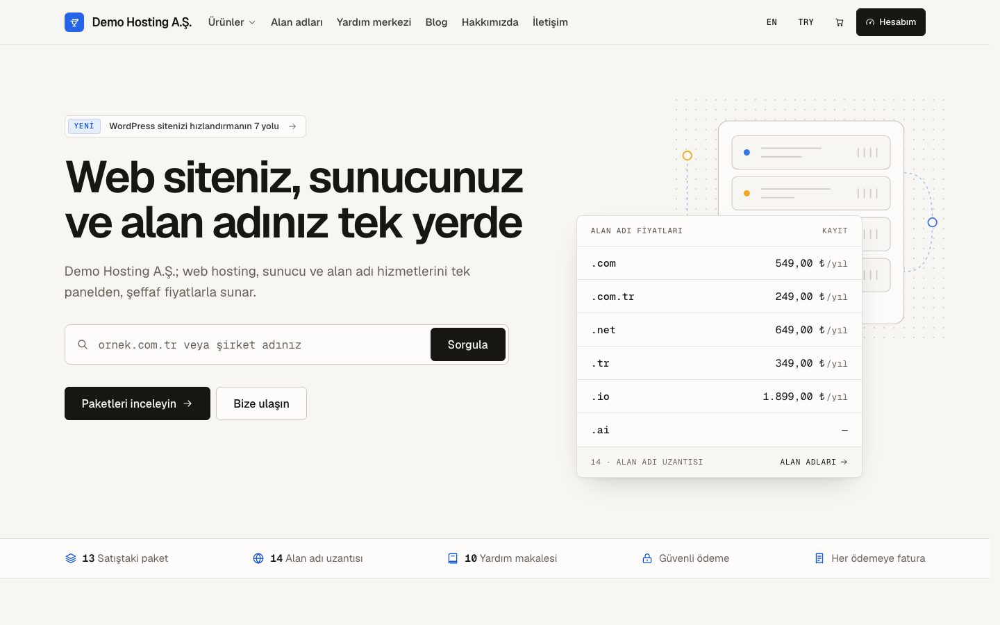

# HostingOS

**English** · [Türkçe](README.tr.md)

HostingOS is open-source software that runs a hosting company: its
storefront, its client area and its admin panel, with billing, automatic
provisioning of hosting accounts and virtual servers, domain management
and support tickets in one application. It is written as an alternative to
WHMCS for hosting companies that want to run their own installation. It is
one Rust binary (`hostingos`) plus PostgreSQL. Despite the name, it is not
an operating system.

> **Early release.** HostingOS is at version 0.1.0 and has not had a tagged
> release yet. Every third-party integration has so far been tested only
> against the provider's documentation and mock servers, not against live
> accounts; see [Known limitations](#known-limitations) before you use it
> with real customers or money.



The screenshots show the Turkish interface; every page is also available in
English. More: [docs/SCREENSHOTS.md](docs/SCREENSHOTS.md).

## Features

**Storefront.** Server-rendered pages in Turkish and English with six
templates (classic, cloud, corporate, editorial, studio, terminal), light
and dark mode, product groups and configurable options, bundles, a currency
switcher, domain search, knowledge base, blog, announcements, downloads,
network status page, contact form and landing pages. SEO: canonical URLs,
hreflang, JSON-LD, sitemap, `robots.txt`, `llms.txt`, Markdown versions of
pages, IndexNow, redirects and a site audit.

**Ordering and billing.** Cart with products, add-ons, bundles and domains;
coupons, tax rules per country or region, several currencies with exchange
rates, account credit. An order becomes an invoice, the payment triggers
provisioning. Recurring invoices, reminders, late fees, refunds, partial
payments, paying several invoices at once, adding funds, invoice PDFs and
quotes that the client can accept online.

**Provisioning.** Hosting accounts on cPanel/WHM, Plesk, DirectAdmin and
CyberPanel (create, suspend, unsuspend, terminate, package change,
password reset, single sign-on). Virtual servers on Proxmox VE, VMware,
Virtualizor and Hetzner Cloud: power actions, reinstall, snapshots,
backups, browser console, rescue mode, ISO, firewall, reverse DNS, graphs,
SSH keys and IP pools, as far as the platform supports each action.

**Domains.** Registration, transfer, renewal, name servers, lock, privacy,
EPP code, contacts and DNS through ResellerClub, Namecheap or OpenProvider;
availability through RDAP; TLD price lists.

**Client area.** Services, domains, invoices, payment methods and credit,
quotes, tickets, downloads, an affiliate programme, two-factor
authentication, sessions, API keys, and sub-users who only see the areas
granted to them.

**Support.** Departments, tickets with attachments, canned replies,
internal notes, priorities and bulk actions; tickets opened and answered
by e-mail (Mailgun inbound route or a raw-message endpoint) with a
quarantine for unknown senders.

**Admin panel.** Clients, orders, invoices, services, domains, catalogue,
integrations, e-mail templates, staff roles with fine-grained permissions,
audit log, impersonation of clients, global search, staff tasks, fraud
screening of orders with ban lists, and reports (revenue, MRR and churn,
tax, receivables ageing, best sellers, domain renewals, CSV export).

**Turkey.** e-Fatura and e-Arşiv through Nilvera or Paraşüt (UBL-TR),
payment gateways common in Turkey, Turkish tax ID checks.

**Integrations and API.** REST API (`/api/v1`) with API keys, pagination,
idempotency keys, rate limits and an OpenAPI 3.1 description; signed
outgoing webhooks; signed incoming gateway and registrar webhooks that are
applied once. An importer moves clients, products, services, domains,
invoices, tickets and more from WHMCS, from its database or its API, with
a dry run and rollback.

**Operations.** One binary with the web server, background job queue and
scheduler (or a separate worker process); embedded database migrations;
Docker image and Compose file with Caddy for automatic TLS; systemd unit;
update checks against signed releases, with one-click install and
automatic rollback for binary installs; the owner finds updates,
maintenance mode and system status under Server in the admin panel
(`/admin/server`). Optional AI-generated drafts for
content and SEO (needs an Anthropic API key).

**Security.** argon2id password hashes, CSRF protection, a strict Content
Security Policy, TOTP two-factor authentication, OAuth sign-in (Google,
GitHub), rate limits, encrypted integration credentials and a guard on the
connections the server makes to integration endpoints
([docs/INSTALL.md](docs/INSTALL.md#4-outbound-connections-hos_outbound_policy)).

| Integration | Providers |
|---|---|
| Payment gateways | Stripe, iyzico, PayTR, PayPal, NestPay (Payten), Papara, Paynet, bank transfer |
| Hosting panels | cPanel/WHM, Plesk, DirectAdmin, CyberPanel |
| Virtualisation | Proxmox VE, VMware vSphere (through vCenter), Virtualizor, Hetzner Cloud |
| Domain registrars | ResellerClub, Namecheap, OpenProvider; RDAP lookups |
| E-mail | SMTP, Resend, Postmark, Mailgun |
| E-invoice (Turkey) | Nilvera, Paraşüt |

For development and demos there is also a `mock` provider for payments,
hosting panels, virtualisation, registrars and e-invoices, and a log-only
mailer; production refuses the mocks unless explicitly allowed. Feature
details: [docs/FEATURES.md](docs/FEATURES.md), payments:
[docs/PAYMENTS.md](docs/PAYMENTS.md), e-invoices:
[docs/EINVOICE.md](docs/EINVOICE.md), API: [docs/API.md](docs/API.md),
WHMCS import: [docs/IMPORT-WHMCS.md](docs/IMPORT-WHMCS.md).

## Live demo

**Demo:** https://hostingos.sunucu.com.tr

Log in with one of the published accounts below (the login page also lists
them with a button that fills in the form):

| Role | Login page | E-mail | Password |
|---|---|---|---|
| Hosting company owner (admin panel) | `/auth/login`, then `/admin` | `admin@demo.test` | `demo-admin` |
| Client (with an unpaid VPS order) | `/auth/login`, then `/client` | `musteri@demo.test` | `demo-client` |

- **Everything is reset every 30 minutes.** All data visitors entered is
  deleted and the demo starts again from the same sample data; the banner
  on every page shows the time left.
- **Everyone shares these accounts.** What you type is visible to other
  visitors until the next reset. Do not enter real personal data.
- **Try almost everything.** Order and pay with the mock gateway and watch
  the mock hypervisor set up the VPS, manage clients, invoices and
  tickets, edit products, prices and pages, change the storefront's look.
- **Nothing leaves the server.** Only mock providers are active. E-mails
  the demo "sends" appear in the demo mailbox (`/demo/mailbox`).
- Disabled are only actions that would reach other hosts, lock other
  visitors out or run code: sign-up and password resets, changes to the
  shared logins, real integrations and webhooks, the WHMCS import and
  writes through the REST API. Uploads are limited to images.

How demo mode works: [docs/DEMO.md](docs/DEMO.md); the same demo on your
own computer: [Quick start](#try-it-on-your-computer); a public demo server:
[docs/deploy/DEMO-DEPLOY.md](docs/deploy/DEMO-DEPLOY.md).

## Quick start

### Try it on your computer

This runs HostingOS and PostgreSQL 16 from the prebuilt image on
`http://localhost:8080`, reachable from your computer only. Nothing is
compiled and the repository is not cloned. You need Docker with the
Compose plugin, `curl` and `openssl`.

> **About the image.** The commands below use
> `ghcr.io/sunucu-com-tr/hostingos:edge`, which the project's CI builds
> from the `main` branch each time all tests pass. `edge` follows `main`
> and is **not a signed release**; signed, versioned releases are not
> published yet. The commands work after the first image has been
> published; until then, [build from source](#build-from-source).

```sh
mkdir hostingos-trial && cd hostingos-trial

# The Compose file, saved as compose.yaml:
curl -fsSL -o compose.yaml \
  https://raw.githubusercontent.com/sunucu-com-tr/hostingos/main/docker-compose.quickstart.yml

# Two secrets in .env next to it (keep this file: it holds the database
# password and the key that encrypts stored credentials):
printf 'POSTGRES_PASSWORD=%s\nHOS_SECRET_KEY=%s\n' \
  "$(openssl rand -hex 32)" "$(openssl rand -base64 32)" > .env

# Download and start PostgreSQL and HostingOS; returns once both are healthy:
docker compose up -d --wait

# Create your company and its owner account (prints the password once):
docker compose run --rm app setup --email you@example.com --company "Example Hosting"
```

`docker compose up -d --wait` downloads the images on the first run and
finishes when both containers report healthy, with lines like these:

```text
 ✔ Container hostingos-trial-postgres-1  Healthy
 ✔ Container hostingos-trial-app-1       Healthy
```

`setup` applies the database migrations, creates the company and ends with:

```text
company created: Example Hosting
admin panel: http://localhost:8080/admin
owner login: you@example.com
password:    <generated password>   (shown once; change it after signing in)
```

Sign in at `http://localhost:8080/auth/login` with that e-mail address and
password. The admin panel is at `/admin`, the storefront at `/`, the client
area at `/client`. Until `setup` has run, every page answers
`503 Service Unavailable`. No e-mail is sent until you set up a mail
integration; until then mail only appears in the log
(`docker compose logs app`). Port 8080 taken? Put `HOS_PORT=8090` in `.env`
and run `docker compose up -d --wait` again.

**Try the demo data instead.** In the same directory, one command starts a
second, separate installation in demo mode on port 8081, with its own
database: a populated shop, the demo logins `admin@demo.test` /
`demo-admin` (admin panel) and `musteri@demo.test` / `demo-client` (client
area), mock payment, server and domain providers, and a reset of all data
every 30 minutes ([docs/DEMO.md](docs/DEMO.md)):

```sh
HOS_DEMO_MODE=1 HOS_PORT=8081 docker compose -p hostingos-demo up -d --wait
```

Then open `http://localhost:8081/auth/login`; the login page has a button
for each demo account.

**Update** to the newest `edge` image:

```sh
docker compose pull && docker compose up -d
```

The new container applies pending database migrations before it opens its
port; your data stays in its volume. For the demo, run its `up` command
again after the pull.

**Stop and remove:**

```sh
docker compose down                              # stop and remove the containers, keep the data
docker compose down --volumes                    # ... and delete the database too
docker compose -p hostingos-demo down --volumes  # the demo, if you started it
docker image rm ghcr.io/sunucu-com-tr/hostingos:edge postgres:16-alpine   # the downloaded images
```

Then delete the `hostingos-trial` directory.

### Install on a server

This sets up a production-style installation on one Linux server:
PostgreSQL 16, HostingOS (the same prebuilt image) and Caddy, which
obtains TLS certificates automatically. The full guide, which also covers
backups, updates and a bare-binary install under systemd, is
[docs/INSTALL.md](docs/INSTALL.md).

You need a server with Docker Engine and the Compose plugin, ports 80 and
443 open, and a domain whose DNS points at the server (the example uses
`www.example.com`).

```sh
git clone https://github.com/sunucu-com-tr/hostingos.git hostingos
cd hostingos
cp docs/deploy/env.example .env.production

# Generate the three secrets:
sed -i \
  -e "s|^POSTGRES_PASSWORD=.*|POSTGRES_PASSWORD=$(openssl rand -hex 32)|" \
  -e "s|^HOS_SECRET_KEY=.*|HOS_SECRET_KEY=$(openssl rand -base64 32)|" \
  -e "s|^HOS_TLS_ASK_SECRET=.*|HOS_TLS_ASK_SECRET=$(openssl rand -hex 32)|" \
  .env.production
```

Edit `.env.production`: set `HOS_BASE_URL` to the public address of your
site (`https://www.example.com`) and `ACME_EMAIL` to the e-mail address for
Let's Encrypt. Leave `HOS_MODE=single` as it is in the template: the
installation runs your one company, and every address that reaches it
shows that company. Keep a copy of `HOS_SECRET_KEY` somewhere safe: it encrypts integration
credentials and two-factor secrets, and a database backup is of limited use
without it.

```sh
# Download the image and start PostgreSQL, the migrations, HostingOS and Caddy:
docker compose --env-file .env.production up -d

# Create your company and its owner account (prints the password once):
docker compose --env-file .env.production run --rm app setup \
  --email you@example.com --company "Example Hosting"
```

`docker-compose.yml` runs `ghcr.io/sunucu-com-tr/hostingos:edge` unless
`HOS_IMAGE` / `HOS_TAG` in `.env.production` name another image; to stay on
one build, set `HOS_TAG` to its commit tag (`sha-` and the first seven
characters of the commit). It never builds anything. Database migrations
run automatically (the one-shot `migrate` service) before the application
starts. Until `setup` has run, every page answers
`503 Service Unavailable`. `setup` also takes `--locale tr|en` and
`--currency` (defaults `tr` and `TRY`) and `--password`; without a
password it generates one.

Then log in at `https://www.example.com/auth/login`; the admin panel is at
`/admin`. Turn on two-factor authentication for your account, add your
payment gateways, servers, registrar and mail provider under
Integrations, then your products. Until a mail integration is set up,
e-mails are only written to the log.

### Build from source

If you changed the code, or prefer not to run the published image, build
the image from your checkout with the additional file
`docker-compose.build.yml`. The first build compiles HostingOS and takes a
while; it needs enough memory for the Rust compiler.

```sh
# In the clone from above; applies to every docker compose command in this shell:
export COMPOSE_FILE=docker-compose.yml:docker-compose.build.yml
docker compose --env-file .env.production up -d --build
```

The image built this way is called `hostingos:local`; Compose never pulls
it. For the trial on your computer, build the same image in a clone with
`docker build -t hostingos:local .` and add `HOS_IMAGE=hostingos` and
`HOS_TAG=local` to the trial's `.env`. A bare binary built with `cargo` is
described in [docs/INSTALL.md](docs/INSTALL.md#6-b-bare-binary-under-systemd).

## Configuration

HostingOS is configured with environment variables. The important ones:

| Variable | Required | Meaning |
|---|---|---|
| `DATABASE_URL` | yes | PostgreSQL connection string (pooled) |
| `DATABASE_URL_DIRECT` | recommended | Direct connection for migrations and the job worker; defaults to `DATABASE_URL` |
| `HOS_SECRET_KEY` | yes | 32 random bytes, base64 (`openssl rand -base64 32`); encrypts stored credentials. Back it up |
| `HOS_BASE_URL` | production | Public address of your site; `https` turns on Secure cookies |
| `HOS_MODE` | no | `single` (default): one hosting company, shown on every address that reaches the server |
| `HOS_BIND` | no | Listen address, default `127.0.0.1:8080` (the image uses `0.0.0.0:8080`) |
| `HOS_TRUST_PROXY` | behind a proxy | Read the client address from the reverse proxy's `X-Forwarded-For` |
| `HOS_TRUSTED_PROXY_HOPS` | no | Number of proxies in front of the app, default `1` |
| `HOS_TRUSTED_PROXIES` | recommended behind a proxy | Addresses / CIDR ranges of the proxies; the forwarded headers count only from them (unset: from everyone, with a warning) |
| `HOS_MIGRATE_ON_START` | no | `1`: apply pending migrations before serving (same as `hostingos serve --migrate`) |
| `HOS_OUTBOUND_POLICY` | no | `private` (default: integrations may reach servers on your private network) or `public` (public addresses only) |
| `HOS_TLS_ASK_SECRET` | with Caddy | Shared secret for Caddy's certificate check |
| `HOS_UPDATE_REPO` | no | GitHub `owner/name` to check for signed releases; update checks are off until it is set |

The Compose file additionally reads `POSTGRES_PASSWORD` and `ACME_EMAIL`,
and optionally `HOS_IMAGE` and `HOS_TAG`. Every variable:
[docs/INSTALL.md](docs/INSTALL.md#environment-variables) and
[docs/DEPLOYMENT.md](docs/DEPLOYMENT.md#environment).

## Upgrading

Back up the database first (see [docs/INSTALL.md](docs/INSTALL.md#backups)).
Migrations only move forward; the new version applies them before it
serves requests.

- **Docker Compose with the published image** (the default):
  `docker compose --env-file .env.production pull`, then
  `docker compose --env-file .env.production up -d`. The one-shot `migrate`
  service applies pending migrations before the new application starts.
  `edge` moves with every change on `main`; with a pinned `sha-…` tag,
  change `HOS_TAG` first.
- **Docker Compose, built from source:** `git pull`, then
  `docker compose --env-file .env.production up -d --build` with
  `COMPOSE_FILE` set as in [Build from source](#build-from-source).
- **Bare binary under systemd:** install the new release in the admin
  panel under Server → Updates (`/admin/server/updates`; backup,
  maintenance mode, migrations, health check and automatic rollback) or
  with `hostingos update apply`.

Details: [docs/UPDATES.md](docs/UPDATES.md). Signed, versioned releases do
not exist yet: the published image is `edge` (and one `sha-…` tag per
commit), built from `main` and not signed, and the update page in the
admin panel has no release to offer until the first signed release.

## Security

Please report vulnerabilities privately as described in
[SECURITY.md](SECURITY.md), not in public issues.

## Known limitations

- **Early release.** Version 0.1.0, no tagged release yet. The only
  published images are the unsigned `edge` builds of `main`. The release
  pipeline and the self-update path are new and have not been through a
  real release; no release signing key exists yet, so one-click updates
  cannot install anything until the first signed release.
- **Integrations are untested against live accounts.** Payment gateways,
  hypervisors, hosting panels, registrars, e-invoice providers and the
  Mailgun inbound route have been tested against the providers'
  documentation and mock servers only. Run test transactions in each
  provider's sandbox before you go live.
- **WHMCS import** has not yet been run against a production WHMCS
  database. Run a dry run on a copy of your data and read the report before
  you rely on it ([docs/IMPORT-WHMCS.md](docs/IMPORT-WHMCS.md)).
- **One web instance, or sticky routing.** Rate limiters are kept in memory
  per process; several web instances multiply the limits
  ([docs/DEPLOYMENT.md](docs/DEPLOYMENT.md#scaling)).
- **Payments:** saved cards are not available for every gateway; see
  "Known gaps" in [docs/PAYMENTS.md](docs/PAYMENTS.md).
- **e-Fatura:** return invoices, partial refunds and chargebacks are left to
  staff ([docs/EINVOICE.md](docs/EINVOICE.md)).
- **Languages:** the interface is available in Turkish and English.

## Roadmap

Next steps, in no fixed order: the first signed, versioned release;
checking each integration against the providers' sandbox or live
systems; a trial WHMCS import on real data; a rate limiter shared between
web instances; the contributor licence agreement.

## Contributing

Bug reports, test results from real provider sandboxes and pull requests
are welcome. Read [CONTRIBUTING.md](CONTRIBUTING.md) (build, tests,
conventions and the sign-off rule) and the
[code of conduct](CODE_OF_CONDUCT.md). The architecture is described in
[docs/ARCHITECTURE.md](docs/ARCHITECTURE.md), the web layer in
[crates/hos-web/README.md](crates/hos-web/README.md). Changes are listed in
[CHANGELOG.md](CHANGELOG.md).

## Licence and commercial options

HostingOS is licensed under the GNU Affero General Public License v3.0
only ([LICENSE](LICENSE)). You may use it for any purpose, commercial use
included. If you run a modified version as a network service, you must
offer its source code to its users. [COMMERCIAL.md](COMMERCIAL.md)
explains this in plain words and describes the paid options: a commercial
licence for organisations that cannot accept the AGPL, paid support and
help with migrating from WHMCS. Third-party components and their licences:
[THIRD-PARTY-NOTICES.md](THIRD-PARTY-NOTICES.md).

## Support the project

HostingOS is free to use. If it is useful to you, you can support its
development:

- with a donation or sponsorship, once those options are set up (they will
  be linked here and from the repository's *Sponsor* button);
- by buying support or migration help ([COMMERCIAL.md](COMMERCIAL.md));
- by reporting bugs, testing integrations with your own sandbox accounts,
  and improving the documentation and translations.

Donations are optional and do not buy different terms: everyone gets the
same software under the same licence.
