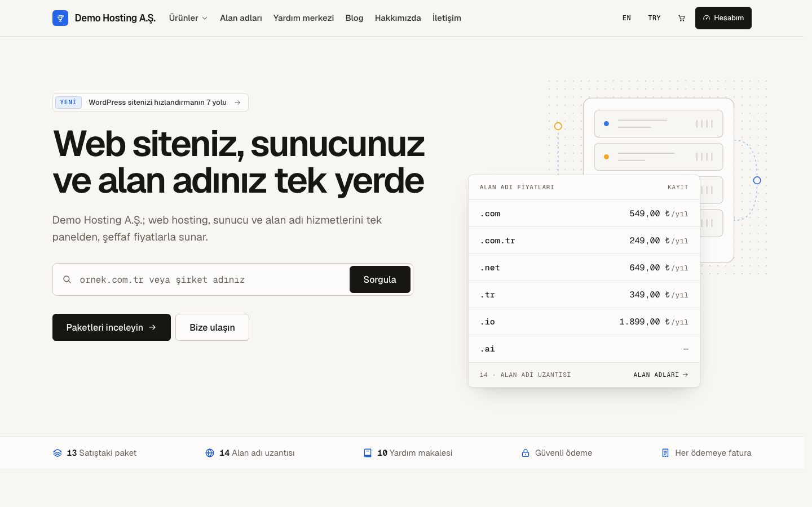

# HostingOS

[English](README.md) · **Türkçe**

HostingOS, bir hosting firmasını yürüten açık kaynaklı bir yazılımdır:
firmanın mağazası (vitrini), müşteri paneli ve yönetim paneli; faturalama,
hosting hesaplarının ve sanal sunucuların otomatik kurulumu, alan adı
yönetimi ve destek talepleriyle birlikte tek bir uygulamada. Kendi
kurulumunu işletmek isteyen hosting firmaları için WHMCS'e alternatif
olarak yazıldı. Tek bir Rust binary'si (`hostingos`) ve PostgreSQL'den
oluşur. Adındaki "OS"a rağmen bir işletim sistemi değildir.

> **Erken sürüm.** HostingOS 0.1.0 sürümünde ve henüz etiketlenmiş bir
> sürümü yok. Üçüncü taraf entegrasyonların tamamı şimdiye kadar yalnızca
> sağlayıcıların belgelerine ve sahte (mock) sunuculara karşı test edildi,
> gerçek hesaplarla denenmedi. Gerçek müşteriler ve gerçek ödemelerle
> kullanmadan önce [Bilinen sınırlamalar](#bilinen-sinirlamalar) bölümünü
> okuyun.



Ekran görüntüleri Türkçe arayüzden alındı; her sayfanın İngilizcesi de
var. Diğer görüntüler: [docs/SCREENSHOTS.md](docs/SCREENSHOTS.md).

## Neler yapabiliyor?

**Mağaza.** Sunucu tarafında oluşturulan Türkçe ve İngilizce sayfalar; yedi
şablon (Atlas, Klasik, Bulut, Kurumsal, Editoryal, Stüdyo, Terminal), açık
ve koyu tema, ürün grupları ve yapılandırılabilir seçenekler, paketler
(bundle), para birimi seçici, alan adı sorgulama, bilgi bankası, blog,
duyurular, dosya indirme merkezi, ağ durumu sayfası, iletişim formu ve
açılış sayfaları. SEO tarafında canonical adresler, hreflang, JSON-LD,
sitemap, `robots.txt`, `llms.txt`, sayfaların Markdown sürümleri,
IndexNow, yönlendirmeler ve site denetimi.

**Sipariş ve faturalama.** Ürün, eklenti, paket ve alan adını aynı sepette
toplayan sipariş akışı; kuponlar, ülke ya da bölgeye göre vergi kuralları,
kurlarıyla birlikte birden çok para birimi, müşteri bakiyesi. Sipariş
faturaya dönüşür, ödeme gelince hizmet kendiliğinden kurulur. Yinelenen
faturalar, hatırlatmalar, gecikme bedeli, iadeler, kısmi ödemeler, birden
çok faturayı tek seferde ödeme, bakiye yükleme, fatura PDF'leri ve
müşterinin çevrim içi onaylayabildiği teklifler.

**Otomatik kurulum.** cPanel/WHM, Plesk, DirectAdmin ve CyberPanel üzerinde
hosting hesapları (açma, askıya alma, askıdan çıkarma, silme, paket
değiştirme, parola sıfırlama, tek tıkla panele giriş). Proxmox VE, VMware,
Virtualizor ve Hetzner Cloud üzerinde sanal sunucular: açma/kapama,
yeniden kurulum, snapshot, yedek, tarayıcıdan konsol, kurtarma modu, ISO,
güvenlik duvarı, ters DNS, grafikler, SSH anahtarları ve IP havuzları;
her işlem, platformun desteklediği ölçüde.

**Alan adları.** ResellerClub, Namecheap ya da OpenProvider üzerinden
kayıt, transfer, yenileme, name server, kilit, gizlilik, EPP kodu, kişi
bilgileri ve DNS; RDAP ile müsaitlik sorgusu; uzantı fiyat listeleri.

**Müşteri paneli.** Hizmetler, alan adları, faturalar, ödeme yöntemleri ve
bakiye, teklifler, destek talepleri, dosyalar, ortaklık (affiliate)
programı, iki adımlı doğrulama, oturumlar, API anahtarları ve yalnızca
izin verilen bölümleri gören alt kullanıcılar.

**Destek.** Departmanlar, ekli talepler, hazır yanıtlar, iç notlar,
öncelikler ve toplu işlemler. Talepler e-postayla da açılıp yanıtlanabilir
(Mailgun inbound route ya da ham ileti uç noktası); tanınmayan
gönderenlerin e-postaları karantinaya alınır.

**Yönetim paneli.** Müşteriler, siparişler, faturalar, hizmetler, alan
adları, ürün kataloğu, entegrasyonlar, e-posta şablonları, ayrıntılı
yetkilere sahip personel rolleri, denetim kaydı, müşteri hesabına geçiş
(impersonation), genel arama, yapılacaklar listesi, yasak listeleriyle
sipariş dolandırıcılık kontrolü ve raporlar (gelir, MRR ve kayıp oranı,
vergi, vadesi geçmiş alacaklar, en çok satanlar, alan adı yenilemeleri,
CSV dışa aktarma).

**Türkiye'ye özel.** Nilvera ya da Paraşüt üzerinden e-Fatura ve e-Arşiv
(UBL-TR), Türkiye'de yaygın ödeme altyapıları (iyzico, PayTR, Nestpay,
Papara, Paynet, havale/EFT), VKN / TCKN kontrolü, Türkçe arayüz ve TL.

**Entegrasyon ve API.** API anahtarlı REST API (`/api/v1`): sayfalama,
idempotency anahtarları, hız sınırları ve OpenAPI 3.1 tanımı. İmzalı giden
webhook'lar; ödeme altyapılarından ve registrar'lardan gelen imzalı
webhook'lar ve her birinin yalnızca bir kez işlenmesi. WHMCS'ten aktarım:
müşteriler, ürünler, hizmetler, alan adları, faturalar, destek talepleri
ve daha fazlası, WHMCS veritabanından ya da API'sinden; deneme çalıştırması
ve geri alma ile.

**İşletim.** Web sunucusu, arka plan iş kuyruğu ve zamanlayıcı tek binary'de
(ya da ayrı bir worker sürecinde); programa gömülü veritabanı
migration'ları; otomatik TLS için Caddy'li Docker imajı ve Compose dosyası;
systemd birimi; imzalı sürümlere karşı güncelleme denetimi, binary
kurulumlarında tek tıkla kurulum ve sorun çıkarsa otomatik geri alma;
güncellemeler, bakım modu ve sistem durumu, yönetim panelinde firma
sahibine açık Sunucu bölümündedir (`/admin/server`). İçerik
ve SEO için isteğe bağlı yapay zekâ taslakları (Anthropic API anahtarı
gerekir).

**Güvenlik.** argon2id parola özetleri, CSRF koruması, sıkı Content
Security Policy, TOTP ile iki adımlı doğrulama, OAuth ile giriş (Google,
GitHub), hız sınırları, şifreli saklanan entegrasyon bilgileri ve sunucunun
entegrasyonlara açtığı bağlantılar için koruma
([docs/INSTALL.tr.md](docs/INSTALL.tr.md#dis-baglantilar)).

| Entegrasyon | Sağlayıcılar |
|---|---|
| Ödeme altyapıları | Stripe, iyzico, PayTR, PayPal, Nestpay (Payten), Papara, Paynet, havale/EFT |
| Hosting panelleri | cPanel/WHM, Plesk, DirectAdmin, CyberPanel |
| Sanallaştırma | Proxmox VE, VMware vSphere (vCenter üzerinden), Virtualizor, Hetzner Cloud |
| Alan adı registrar'ları | ResellerClub, Namecheap, OpenProvider; RDAP sorgusu |
| E-posta | SMTP, Resend, Postmark, Mailgun |
| e-Fatura / e-Arşiv | Nilvera, Paraşüt |

Geliştirme ve demo için ödeme, panel, sanallaştırma, registrar ve e-Fatura
kategorilerinde birer `mock` sağlayıcı, e-postada da yalnızca loga yazan
bir gönderici var; canlı kurulumda mock sağlayıcılar, açıkça izin
verilmedikçe reddedilir. Ayrıntılı belgeler (İngilizce): özellikler
[docs/FEATURES.md](docs/FEATURES.md), ödemeler
[docs/PAYMENTS.md](docs/PAYMENTS.md), e-Fatura
[docs/EINVOICE.md](docs/EINVOICE.md), API [docs/API.md](docs/API.md),
WHMCS aktarımı [docs/IMPORT-WHMCS.md](docs/IMPORT-WHMCS.md).

## Canlı demo

**Demo:** https://hostingos.sunucu.com.tr

Aşağıdaki herkese açık hesaplardan biriyle giriş yapın (giriş sayfası bu
hesapları, formu tek tıkla dolduran bir düğmeyle birlikte gösterir):

| Rol | Giriş sayfası | E-posta | Parola |
|---|---|---|---|
| Hosting firması sahibi (yönetim paneli) | `/auth/login`, ardından `/admin` | `admin@demo.test` | `demo-admin` |
| Müşteri (ödenmemiş bir VPS siparişiyle) | `/auth/login`, ardından `/client` | `musteri@demo.test` | `demo-client` |

- **Her şey 30 dakikada bir sıfırlanır.** Ziyaretçilerin girdiği bütün
  veriler silinir, demo aynı örnek verilerle yeniden kurulur. Her sayfadaki
  bant, bir sonraki sıfırlamaya kalan süreyi gösterir.
- **Bu hesapları herkes ortak kullanır.** Yazdıklarınız bir sonraki
  sıfırlamaya kadar diğer ziyaretçilere görünür. Gerçek kişisel bilgi
  girmeyin.
- **Neredeyse her şeyi deneyebilirsiniz.** Sipariş verip mock ödeme
  altyapısıyla ödeyin ve VPS'in mock sanallaştırma platformunda
  kurulmasını izleyin; müşterileri, faturaları ve destek taleplerini
  yönetin, ürünleri, fiyatları ve sayfaları düzenleyin, mağazanın
  görünümünü değiştirin.
- **Sunucudan dışarı hiçbir şey çıkmaz.** Yalnızca mock sağlayıcılar
  çalışır. Demonun "gönderdiği" e-postalar demo posta kutusunda
  (`/demo/mailbox`) görünür.
- Yalnızca başka sunuculara ulaşan, diğer ziyaretçileri dışarıda
  bırakabilecek ya da kod çalıştıran işlemler kapalıdır: kayıt olma ve
  parola sıfırlama, ortak hesaplarda değişiklik, gerçek entegrasyonlar ve
  webhook'lar, WHMCS aktarımı ve REST API üzerinden yazma. Yalnızca görsel
  dosyalar yüklenebilir.

Demo modunun nasıl çalıştığı: [docs/DEMO.md](docs/DEMO.md) (İngilizce);
aynı demoyu kendi bilgisayarınızda çalıştırmak için:
[Hızlı başlangıç](#bilgisayarinizda-deneyin); herkese açık bir demo
sunucusu kurmak için:
[docs/deploy/DEMO-DEPLOY.tr.md](docs/deploy/DEMO-DEPLOY.tr.md).

## Hızlı başlangıç

<a id="bilgisayarinizda-deneyin"></a>

### Kendi bilgisayarınızda deneyin

Bu adımlar HostingOS'u ve PostgreSQL 16'yı hazır imajdan çalıştırır;
kurulum yalnızca sizin bilgisayarınızdan erişilebilen
`http://localhost:8080` adresinde açılır. Hiçbir şey derlenmez, depo da
klonlanmaz. Gerekenler: Compose eklentisiyle birlikte Docker, `curl` ve
`openssl`.

> **İmaj hakkında.** Aşağıdaki komutlar
> `ghcr.io/sunucu-com-tr/hostingos:edge` imajını kullanır. Bu imajı
> projenin CI'ı, bütün testler geçtiğinde `main` dalından kendiliğinden
> derler. `edge`, `main` dalını izler ve **imzalı bir sürüm değildir**;
> imzalı ve numaralı sürümler henüz yayımlanmadı. Komutlar, ilk imaj
> yayımlandıktan sonra çalışır; o zamana kadar
> [kaynak koddan derleyin](#kaynaktan-derleme).

```sh
mkdir hostingos-trial && cd hostingos-trial

# Compose dosyası, compose.yaml adıyla:
curl -fsSL -o compose.yaml \
  https://raw.githubusercontent.com/sunucu-com-tr/hostingos/main/docker-compose.quickstart.yml

# Hemen yanındaki .env dosyasına iki gizli değer (bu dosyayı saklayın:
# veritabanı parolasını ve saklanan kimlik bilgilerini şifreleyen anahtarı içerir):
printf 'POSTGRES_PASSWORD=%s\nHOS_SECRET_KEY=%s\n' \
  "$(openssl rand -hex 32)" "$(openssl rand -base64 32)" > .env

# PostgreSQL'i ve HostingOS'u indirip başlatın; ikisi de sağlıklı olunca komut biter:
docker compose up -d --wait

# Firmanızı ve sahip hesabını oluşturun (parola bir kez ekrana yazılır):
docker compose run --rm app setup --email siz@example.com --company "Örnek Hosting"
```

`docker compose up -d --wait` ilk çalıştırmada imajları indirir ve iki
konteyner de sağlıklı (healthy) olduğunda şuna benzer satırlarla biter:

```text
 ✔ Container hostingos-trial-postgres-1  Healthy
 ✔ Container hostingos-trial-app-1       Healthy
```

`setup` veritabanı migration'larını uygular, firmayı oluşturur ve şu
satırlarla biter:

```text
company created: Örnek Hosting
admin panel: http://localhost:8080/admin
owner login: siz@example.com
password:    <üretilen parola>   (shown once; change it after signing in)
```

`http://localhost:8080/auth/login` adresinden bu e-posta adresi ve
parolayla giriş yapın. Yönetim paneli `/admin`, mağaza `/`, müşteri paneli
`/client` altındadır. `setup` çalıştırılana kadar her sayfa
`503 Service Unavailable` yanıtı verir. Bir e-posta entegrasyonu kurana
kadar hiçbir e-posta gönderilmez, yalnızca loga yazılır
(`docker compose logs app`). 8080 portu doluysa `.env` dosyasına
`HOS_PORT=8090` satırını ekleyip `docker compose up -d --wait` komutunu
yeniden çalıştırın.

**Demo verileriyle denemek isterseniz.** Aynı dizinde tek bir komut, 8081
portunda ve kendi veritabanıyla ikinci, ayrı bir kurulumu demo modunda
başlatır: örnek verilerle dolu bir mağaza, `admin@demo.test` /
`demo-admin` (yönetim paneli) ve `musteri@demo.test` / `demo-client`
(müşteri paneli) demo hesapları, mock ödeme, sunucu ve alan adı
sağlayıcıları; bütün veriler 30 dakikada bir sıfırlanır
([docs/DEMO.md](docs/DEMO.md), İngilizce):

```sh
HOS_DEMO_MODE=1 HOS_PORT=8081 docker compose -p hostingos-demo up -d --wait
```

Ardından `http://localhost:8081/auth/login` adresini açın; giriş
sayfasında her demo hesabı için bir düğme vardır.

**Güncelleme** (en yeni `edge` imajına geçmek için):

```sh
docker compose pull && docker compose up -d
```

Yeni konteyner, portunu açmadan önce bekleyen veritabanı migration'larını
uygular; verileriniz Docker biriminde (volume) kalır. Demoyu da
güncellemek için `pull` komutundan sonra demonun `up` komutunu yeniden
çalıştırın.

**Durdurma ve kaldırma:**

```sh
docker compose down                              # konteynerleri durdurup kaldırır, veriler kalır
docker compose down --volumes                    # ... veritabanını da siler
docker compose -p hostingos-demo down --volumes  # başlattıysanız demoyu da
docker image rm ghcr.io/sunucu-com-tr/hostingos:edge postgres:16-alpine   # indirilen imajlar
```

Son olarak `hostingos-trial` dizinini silin.

### Sunucuya kurulum

Bu adımlar tek bir Linux sunucuda canlı kullanıma uygun bir kurulum
yapar: PostgreSQL 16, HostingOS (aynı hazır imaj) ve TLS sertifikalarını
kendisi alan Caddy. Yedekleme, güncelleme ve systemd altında binary
kurulumunu da anlatan eksiksiz rehber:
[docs/INSTALL.tr.md](docs/INSTALL.tr.md).

Gerekenler: Docker Engine ve Compose eklentisi kurulu, 80 ve 443 portları
açık bir sunucu ve DNS kaydı bu sunucuyu gösteren bir alan adı (örnekte
`www.example.com`).

```sh
git clone https://github.com/sunucu-com-tr/hostingos.git hostingos
cd hostingos
cp docs/deploy/env.example .env.production

# Üç gizli anahtarı üretin:
sed -i \
  -e "s|^POSTGRES_PASSWORD=.*|POSTGRES_PASSWORD=$(openssl rand -hex 32)|" \
  -e "s|^HOS_SECRET_KEY=.*|HOS_SECRET_KEY=$(openssl rand -base64 32)|" \
  -e "s|^HOS_TLS_ASK_SECRET=.*|HOS_TLS_ASK_SECRET=$(openssl rand -hex 32)|" \
  .env.production
```

`.env.production` dosyasında `HOS_BASE_URL` değerini sitenizin herkese
açık adresi (`https://www.example.com`), `ACME_EMAIL` değerini de Let's
Encrypt için kullanılacak e-posta adresi yapın. Şablondaki
`HOS_MODE=single` satırını olduğu gibi bırakın: kurulum tek firmanızı
çalıştırır ve sunucuya ulaşan her adres bu firmayı gösterir.
`HOS_SECRET_KEY`'in bir kopyasını güvenli bir yerde saklayın:
entegrasyon bilgilerini ve iki adımlı doğrulama anahtarlarını şifreler; o
olmadan bir veritabanı yedeğinin değeri sınırlıdır.

```sh
# İmajı indirip PostgreSQL'i, migration'ları, HostingOS'u ve Caddy'yi başlatın:
docker compose --env-file .env.production up -d

# Firmanızı ve sahip hesabını oluşturun (parola bir kez ekrana yazılır):
docker compose --env-file .env.production run --rm app setup \
  --email siz@example.com --company "Örnek Hosting"
```

`.env.production` içindeki `HOS_IMAGE` / `HOS_TAG` başka bir imaj
belirtmedikçe `docker-compose.yml` `ghcr.io/sunucu-com-tr/hostingos:edge`
imajını çalıştırır; tek bir derlemede kalmak için `HOS_TAG` değerini o
derlemenin commit etiketi yapın (`sha-` ve commit'in ilk yedi karakteri).
Bu dosya hiçbir şey derlemez. Veritabanı migration'ları uygulama
başlamadan önce kendiliğinden çalışır (tek seferlik `migrate` servisi).
`setup` çalıştırılana kadar her sayfa `503 Service Unavailable` yanıtı
verir. `setup` ayrıca `--locale tr|en`, `--currency` (varsayılanlar `tr` ve
`TRY`) ve `--password` seçeneklerini alır; parola verilmezse kendisi
üretir.

Ardından `https://www.example.com/auth/login` adresinden giriş yapın;
yönetim paneli `/admin` altındadır. Hesabınız için iki adımlı doğrulamayı
açın, Entegrasyonlar altında ödeme altyapılarınızı, sunucularınızı,
registrar'ınızı ve e-posta sağlayıcınızı, ardından ürünlerinizi ekleyin.
E-posta entegrasyonu kurulana kadar e-postalar yalnızca loga yazılır.

<a id="kaynaktan-derleme"></a>

### Kaynak koddan derleme

Kodu değiştirdiyseniz ya da yayımlanmış imajı kullanmak istemiyorsanız,
imajı ek `docker-compose.build.yml` dosyasıyla kendi kopyanızdan derleyin.
İlk derleme HostingOS'u baştan derlediği için biraz sürer ve Rust
derleyicisine yetecek kadar bellek ister.

```sh
# Yukarıdaki klonda; bu kabukta çalıştıracağınız her docker compose komutu için geçerlidir:
export COMPOSE_FILE=docker-compose.yml:docker-compose.build.yml
docker compose --env-file .env.production up -d --build
```

Bu yolla derlenen imajın adı `hostingos:local`'dır; Compose onu hiçbir
zaman bir yerden indirmeye çalışmaz. Bilgisayarınızdaki deneme kurulumu
için aynı imajı bir klonda `docker build -t hostingos:local .` komutuyla
derleyin ve deneme dizinindeki `.env` dosyasına `HOS_IMAGE=hostingos` ve
`HOS_TAG=local` satırlarını ekleyin. `cargo` ile derlenen tek binary
kurulumu [docs/INSTALL.tr.md](docs/INSTALL.tr.md#kurulum-systemd)
dosyasında anlatılır.

## Yapılandırma

HostingOS ortam değişkenleriyle yapılandırılır. Önemli olanlar:

| Değişken | Zorunlu mu? | Anlamı |
|---|---|---|
| `DATABASE_URL` | evet | PostgreSQL bağlantı adresi (havuzlu olabilir) |
| `DATABASE_URL_DIRECT` | önerilir | Migration'lar ve iş kuyruğu için doğrudan bağlantı; verilmezse `DATABASE_URL` |
| `HOS_SECRET_KEY` | evet | 32 rastgele bayt, base64 (`openssl rand -base64 32`); saklanan gizli bilgileri şifreler. Yedekleyin |
| `HOS_BASE_URL` | canlıda | Sitenizin herkese açık adresi; `https` ise çerezler Secure olur |
| `HOS_MODE` | hayır | `single` (varsayılan): tek hosting firması; sunucuya ulaşan her adres bu firmayı gösterir |
| `HOS_BIND` | hayır | Dinlenen adres, varsayılan `127.0.0.1:8080` (imajda `0.0.0.0:8080`) |
| `HOS_TRUST_PROXY` | proxy arkasında | İstemci adresini reverse proxy'nin `X-Forwarded-For` başlığından oku |
| `HOS_TRUSTED_PROXY_HOPS` | hayır | Uygulamanın önündeki proxy sayısı, varsayılan `1` |
| `HOS_TRUSTED_PROXIES` | proxy arkasında önerilir | Proxy'lerin adresleri / CIDR aralıkları; iletilen başlıklar yalnızca onlardan gelince dikkate alınır (boşsa herkesten, uyarıyla) |
| `HOS_MIGRATE_ON_START` | hayır | `1`: bekleyen migration'ları hizmete başlamadan önce uygula (`hostingos serve --migrate` ile aynı) |
| `HOS_OUTBOUND_POLICY` | hayır | `private` (varsayılan: entegrasyonlar yerel ağınızdaki sunuculara ulaşabilir) ya da `public` (yalnızca genel adresler) |
| `HOS_TLS_ASK_SECRET` | Caddy ile | Caddy'nin sertifika kontrolü için paylaşılan anahtar |
| `HOS_UPDATE_REPO` | hayır | İmzalı sürümlerin aranacağı GitHub deposu (`sahip/ad`); verilmedikçe güncelleme denetimi kapalıdır |

Compose dosyası ayrıca `POSTGRES_PASSWORD` ve `ACME_EMAIL` değerlerini,
isteğe bağlı olarak da `HOS_IMAGE` ve `HOS_TAG` değerlerini okur. Bütün
değişkenler:
[docs/INSTALL.tr.md](docs/INSTALL.tr.md#ortam-degiskenleri).

## Sürüm yükseltme

Önce veritabanının yedeğini alın (bkz.
[docs/INSTALL.tr.md](docs/INSTALL.tr.md#yedekleme)). Migration'lar yalnızca
ileri gider; yeni sürüm bunları istek karşılamaya başlamadan önce uygular.

- **Yayımlanmış imajla Docker Compose** (varsayılan):
  `docker compose --env-file .env.production pull`, ardından
  `docker compose --env-file .env.production up -d`. Tek seferlik
  `migrate` servisi, yeni uygulama başlamadan önce bekleyen migration'ları
  uygular. `edge`, `main` dalındaki her değişiklikle ilerler; bir `sha-…`
  etiketine sabitlediyseniz önce `HOS_TAG`'i değiştirin.
- **Kaynaktan derlenen Docker Compose:** `git pull`, ardından
  [Kaynak koddan derleme](#kaynaktan-derleme) bölümündeki gibi
  `COMPOSE_FILE` ayarlıyken
  `docker compose --env-file .env.production up -d --build`.
- **systemd altında binary:** yeni sürümü yönetim panelinde Sunucu →
  Güncellemeler sayfasından (`/admin/server/updates`) kurun (yedek, bakım
  modu, migration'lar, sağlık kontrolü ve gerekirse otomatik geri alma
  kendiliğinden yapılır) ya da `hostingos update apply` komutunu
  kullanın.

Ayrıntılar: [docs/UPDATES.md](docs/UPDATES.md) (İngilizce). İmzalı ve
numaralı sürümler henüz yok: yayımlanan imaj `edge`'dir (ve her commit
için bir `sha-…` etiketi); `main` dalından derlenir, imzalı değildir.
İlk imzalı sürüme kadar yönetim panelindeki güncelleme sayfasının
önerebileceği bir sürüm de yoktur.

## Güvenlik

Güvenlik açıklarını herkese açık issue'larda değil,
[SECURITY.md](SECURITY.md) dosyasında anlatıldığı gibi gizli olarak
bildirin.

<a id="bilinen-sinirlamalar"></a>

## Bilinen sınırlamalar

- **Erken sürüm.** Sürüm 0.1.0, henüz etiketlenmiş bir sürüm yok.
  Yayımlanmış imajlar yalnızca `main` dalının imzasız `edge`
  derlemeleridir. Sürüm yayımlama hattı ve kendi kendini güncelleme yolu
  yeni ve henüz gerçek bir sürüm yayımında denenmedi. Sürüm imzalama
  anahtarı da henüz yok; bu yüzden ilk imzalı sürüme kadar tek tıkla
  güncelleme hiçbir şey kuramaz.
- **Entegrasyonlar gerçek hesaplarla denenmedi.** Ödeme altyapıları,
  sanallaştırma platformları, hosting panelleri, registrar'lar, e-Fatura
  entegratörleri ve Mailgun inbound route yalnızca sağlayıcıların
  belgelerine ve mock sunuculara karşı test edildi. Canlıya geçmeden önce
  her sağlayıcının test ortamında deneme işlemleri yapın.
- **WHMCS aktarımı** henüz canlı bir WHMCS veritabanı üzerinde
  çalıştırılmadı. Güvenmeden önce verilerinizin bir kopyası üzerinde
  deneme çalıştırması yapıp raporu okuyun
  ([docs/IMPORT-WHMCS.md](docs/IMPORT-WHMCS.md)).
- **Tek web süreci ya da yapışkan yönlendirme.** Hız sınırları her sürecin
  belleğinde tutulur; birden çok web süreci sınırları katlar
  ([docs/DEPLOYMENT.md](docs/DEPLOYMENT.md#scaling)).
- **Ödemeler:** kayıtlı kart her ödeme altyapısında yok; bkz.
  [docs/PAYMENTS.md](docs/PAYMENTS.md) içindeki "Known gaps".
- **e-Fatura:** iade faturaları, kısmi iadeler ve ters ibrazlar personele
  bırakılır ([docs/EINVOICE.md](docs/EINVOICE.md)).
- **Diller:** arayüz Türkçe ve İngilizcedir.

## Yol haritası

Sıradaki adımlar, belirli bir sıra olmadan: imzalı ve numaralı ilk sürüm;
her entegrasyonun sağlayıcının test ya da canlı ortamında
denenmesi; gerçek veriyle deneme amaçlı bir WHMCS aktarımı; web süreçleri
arasında paylaşılan bir hız sınırlayıcı; katkıcı lisans sözleşmesi (CLA).

## Katkıda bulunma

Hata bildirimleri, sağlayıcıların test ortamlarında yaptığınız denemelerin
sonuçları ve pull request'ler memnuniyetle karşılanır.
[CONTRIBUTING.md](CONTRIBUTING.md) (derleme, testler, kurallar ve
sign-off kuralı) ile [davranış kurallarını](CODE_OF_CONDUCT.md) okuyun.
Mimari [docs/ARCHITECTURE.md](docs/ARCHITECTURE.md), web katmanı
[crates/hos-web/README.md](crates/hos-web/README.md) dosyasında anlatılır.
Değişiklikler [CHANGELOG.md](CHANGELOG.md) dosyasındadır.

## Lisans ve ticari seçenekler

HostingOS, GNU Affero Genel Kamu Lisansı sürüm 3 (yalnızca bu sürüm) ile
lisanslanmıştır ([LICENSE](LICENSE)). Ticari kullanım dahil her amaçla
kullanabilirsiniz. Değiştirilmiş bir sürümü ağ üzerinden hizmet olarak
sunarsanız, kaynak kodunu o hizmetin kullanıcılarına sunmanız gerekir.
[COMMERCIAL.tr.md](COMMERCIAL.tr.md) bunu sade bir dille açıklar ve ücretli
seçenekleri anlatır: AGPL'yi kabul edemeyen kurumlar için ticari lisans,
ücretli destek ve WHMCS'ten geçiş desteği. Üçüncü taraf bileşenler ve
lisansları: [THIRD-PARTY-NOTICES.md](THIRD-PARTY-NOTICES.md).

## Projeyi destekleyin

HostingOS'u kullanmak ücretsizdir. İşinize yarıyorsa gelişimine şu
yollarla destek olabilirsiniz:

- bağış ya da sponsorluk seçenekleri hazır olduğunda bağış yaparak (burada
  ve deponun *Sponsor* düğmesinde yer alacaklar);
- destek ya da WHMCS'ten geçiş yardımı satın alarak
  ([COMMERCIAL.tr.md](COMMERCIAL.tr.md));
- hata bildirerek, entegrasyonları kendi test hesaplarınızla deneyerek,
  belgeleri ve çevirileri geliştirerek.

Bağış isteğe bağlıdır ve farklı koşullar satın almaz: herkes aynı yazılımı
aynı lisansla kullanır.
